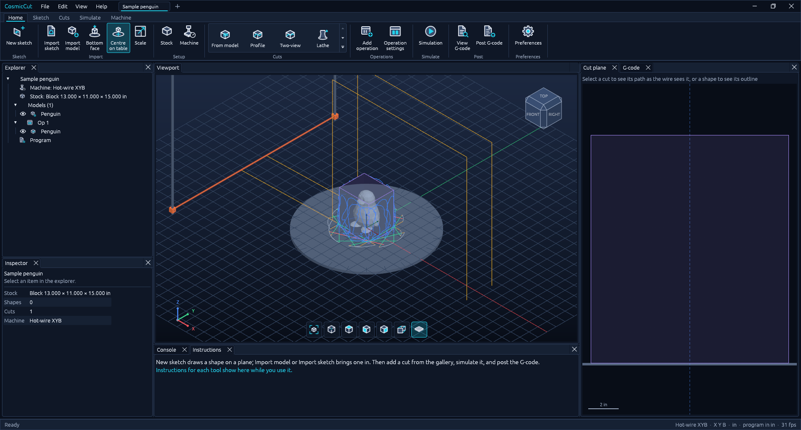

# CosmicCut

**CAM for hot-wire foam cutters with a B-axis turntable.** The wire moves in X (across) and
Y (up) over a turntable (B). Import a 3D model or sketch a 2D shape, set up the cuts, watch the
foam come away in the simulation, and post G-code for the machine.

**[Download for Windows, macOS or Linux](https://github.com/andrewhughes86/CosmicCut/releases/latest)**
· **[Run it in your browser](https://andrewhughes86.github.io/CosmicCut/)**, nothing to install

## Download

| System | Download |
| --- | --- |
| Windows 10/11, 64-bit | [Installer (.exe)](https://github.com/andrewhughes86/CosmicCut/releases/latest/download/CosmicCut-windows-x64-setup.exe) · [Portable (.zip)](https://github.com/andrewhughes86/CosmicCut/releases/latest/download/CosmicCut-windows-x64.zip) |
| macOS 11 or later, Apple silicon and Intel | [Disk image (.dmg)](https://github.com/andrewhughes86/CosmicCut/releases/latest/download/CosmicCut-macos-universal.dmg) |
| Linux x86-64, Debian / Ubuntu | [Package (.deb)](https://github.com/andrewhughes86/CosmicCut/releases/latest/download/CosmicCut-linux-amd64.deb) |
| Linux x86-64, any distribution | [Archive (.tar.gz)](https://github.com/andrewhughes86/CosmicCut/releases/latest/download/CosmicCut-linux-x86_64.tar.gz) |
| Any modern browser | [andrewhughes86.github.io/CosmicCut](https://andrewhughes86.github.io/CosmicCut/) |

Every version is on the [releases page](https://github.com/andrewhughes86/CosmicCut/releases).

**Installing**

- **Windows:** run the installer. The app isn't code-signed yet, so SmartScreen may show
  "Windows protected your PC". Choose **More info → Run anyway**.
- **macOS:** open the .dmg and drag CosmicCut to Applications. The app isn't notarized yet,
  so the first time you open it, right-click it in Applications and choose **Open**, then
  **Open** again. If macOS says the app is damaged, run
  `xattr -dr com.apple.quarantine /Applications/CosmicCut.app` in Terminal.
- **Linux:** `sudo apt install ./CosmicCut-linux-amd64.deb`, then start CosmicCut from the app
  menu or run `cosmiccut`. From the .tar.gz, unpack it and run `./CosmicCut`, or run
  `./install.sh` to add it to your app menu (for your user only).
- **Browser:** works in browsers with WebGPU or WebGL 2. Open and Import upload a file into the
  page, and Save and Post G-code download one. Settings are kept in the browser.

Settings, machines and post processors are kept per user and carry over to new versions.

## What it does

- **Cuts from 3D models.** Import STL, OBJ, 3MF, PLY, STEP, IGES, SAT and more. **From model**
  turns the table step by step and follows the model's outline at every angle.
- **Sketches.** Lines, rectangles, circles, arcs, polygons and points on the front, right or top
  plane. Sketches snap to points, midpoints and alignments, take constraints and dimensions
  (driven by a solver), and include R and C shortcuts for tangent arcs and chamfers. DXF, SVG,
  airfoil .dat and XY point files import as sketches you can edit, and there's a NACA airfoil
  generator.
- **Cut types.** Profile (single or indexed around the table), Two-view (front and side),
  Lathe (a half profile turned on the table) and Slabs (sheets sliced from the block).
- **The part stays put.** Cuts leave the part joined to the foam under it while the table turns,
  and a final release cut frees it.
- **Simulation** of the whole program. The table turns with the foam on it, the waste falls
  away, and the wire's X, Y and B are shown as it moves.
- **G-code you control.** Machine and post processor libraries with HotwireCNC, LinuxCNC,
  Mach3/Mach4 and generic posts. Every block of code, the units, decimals, arcs, comments and
  end moves can be edited.
- **Safe moves.** The table only turns with the wire clear of the foam, the wire never goes
  below Y0, and the program starts and ends at home, going over the part only when it's in the
  way.
- **Multiple jobs** in tabs, each with its own undo history.

## Quick start

CosmicCut opens with a sample job: a penguin cut from a foam block with a profile every 22.5°.
Press **Simulation** to watch it, then **View G-code**. To make your own job:

1. **Machine** (Home tab): check the travel, where the turntable's axis is, the kerf and the
   feed. **Post processor** (Machine tab) sets how the G-code is written. The defaults suit a
   HotwireCNC machine: 100 × 55 in travel, turntable axis at X 50, Y0 at the table top, a
   0.033 in kerf, and programs in inches.
2. **Stock**: a block or a round, its size, and where it stands. You can also type sizes on
   the dimensions shown in the viewport.
3. Bring in a part:
   - **Import model**: it stands centred on the turntable. **Bottom face** picks the face it
     sits on, and **Scale** fits it to the stock.
   - **New sketch**: pick a plane, draw, dimension, then **Finish sketch**.
   - **Import sketch**: DXF, SVG, airfoil .dat or XY points.
4. **Add a cut** from the gallery: **From model** for a model, or Profile, Two-view, Lathe or
   Slabs for a sketch. It opens in the **Cut** tab with a live preview. **Pick the start
   point** chooses where the wire goes in.
5. **Simulation** to check it, then **Post G-code** to save the program.

**Add operation** splits the program at a machine stop (`M0`/`M1`, with a message), for
example to turn the stock by hand between cuts. The **Instructions** tab under the viewport
tells you what the tool you're using wants next.

## Sketching

Click **New sketch**, then click the plane to draw on. The view turns square to it and a grid
is drawn every 4 in (or 100 mm).

| Key or action | Does |
| --- | --- |
| Line, Rectangle, Circle, Arc, Polygon, Point | Draw. Esc or right-click stops a line |
| **R** / **C** while drawing lines | Next segment is a tangent arc / a 45° chamfer towards the mouse |
| **D** | Dimension: a line, circle or arc; a second item gives a distance or angle |
| Click a dimension | Type a new size (typing replaces the value). Drag it to move it; right-click to delete |
| Ctrl/Shift-click | Add to the selection. Constraints that don't suit the selection are greyed out |
| Drag on empty space | Window select: left to right takes items fully inside, right to left anything touched |
| **Ctrl+A** · **M** · Delete | Select all · move the selection or the whole sketch · delete |

Snaps (end points, midpoints, curves, lining up with other points or the origin) become
constraints automatically. A fully constrained sketch turns from cyan to white. Anything the
solver can't satisfy is refused and the sketch stays as it was.

## The machine and the G-code

The table frame has its origin on the turntable's axis at the table top, with Z up and the
wire running along Y at B = 0. Machine X = turntable X + offset across, and machine Y = height
above the table minus the wire's height at Y0 (0 by default, so Y0 is the table top).

By default the post writes RS274/NGC: `G17 G90 G91.1 G40 G49 G94`, `G20`/`G21`, `M3` with a
2 s preheat, `G0`/`G1` with `X Y B`, `G2`/`G3` for arcs, and `M5 M2`. At the end the wire
switches off, the table turns square (to B0 or B180, whichever is nearer) with the wire clear
of the foam, and the wire goes home to X0 Y0. A program that goes outside the machine's travel
says so in its header and in the status bar.

The console takes the same commands as the buttons, in millimetres and degrees whatever the
display units, e.g. `cut.slab {"thickness": 50.8, "skim": 6.35}`.

> **HotwireCNC:** its G-code interpreter ignores `B` words for now, so programs at B = 0
> (profiles, slabs) run there today. Programs that turn the table need B support in that
> controller first.

## Building from source

You need [Rust](https://rustup.rs) 1.88 or newer.

    cargo run --release                  # opens the sample job
    cargo run --release -- job.ccut      # opens a job; --empty starts blank, --help lists the rest

The browser version is built with [Trunk](https://trunkrs.dev):

    rustup target add wasm32-unknown-unknown
    cd apps/CosmicCut && trunk serve --release

Before sending changes:

    cargo fmt --all
    cargo clippy --workspace --all-targets
    cargo test --workspace

`AGENTS.md` has the project's rules (no panics, everything is a command, original icons).
`samples/` has models and drawings to try: the penguin, an L-bracket, a DXF arch and an SVG
chess-pawn half profile.

### Releases and the web version

- Every push to `main` rebuilds the browser version on GitHub Pages
  (`.github/workflows/pages.yml`).
- Pushing a version tag builds the Windows, macOS and Linux packages and publishes a release
  (`.github/workflows/release.yml`; the packaging files are in `packaging/`):

      git tag v0.1.0
      git push origin v0.1.0

  Bump `version` in the root `Cargo.toml` first for a new version.

### Layout

| Crate | Holds |
| --- | --- |
| `crates/geom` | Vectors, regions and offsets, voxel stock, arc fitting |
| `crates/io` | Model readers, 2D shape import, file access (disk, or uploads and downloads in a browser) |
| `crates/render` | Camera, view cube, scene buffers |
| `crates/engine` | Session and commands, machine, stock, sketches, cuts, program, simulation, post |
| `crates/ui-egui` | Ribbon, dock, panels, viewport |
| `apps/CosmicCut` | The desktop app and the browser page |

The interface and much of the code come from CosmicDMS: the same ribbon, dockable workspace,
theme, icons, viewport and command system.

## License

MIT or Apache-2.0, at your option ([LICENSE-MIT](LICENSE-MIT), [LICENSE-APACHE](LICENSE-APACHE)).
Third-party assets are listed in [ATTRIBUTION.md](ATTRIBUTION.md).
