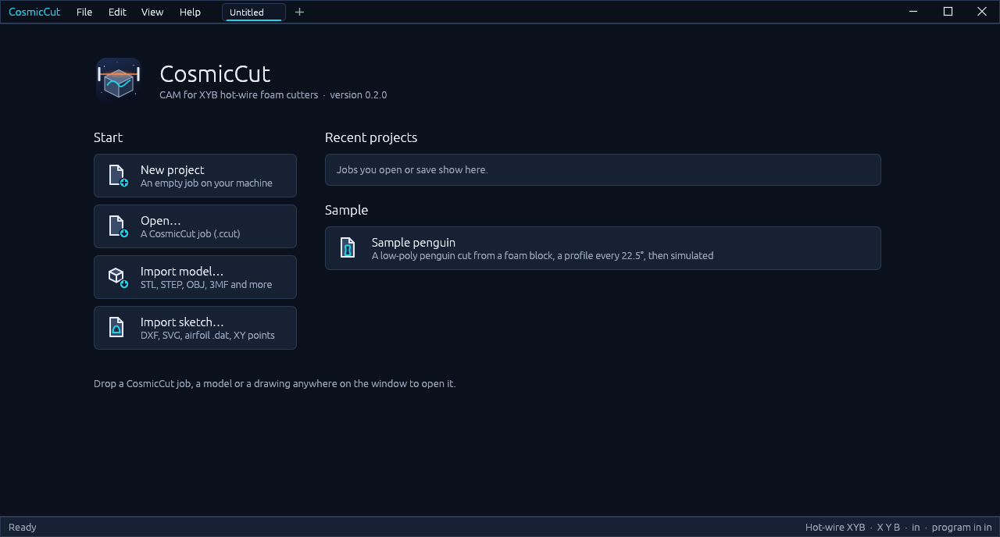

# CosmicCut

**CAM for hot-wire foam cutters with a B-axis turntable.** The wire moves in X (across) and
Y (up) over a turntable (B). Import a 3D model or sketch a 2D shape, set up the cuts, watch the
foam come away in the simulation, and post G-code for the machine.

**[Download for Windows, macOS or Linux](https://github.com/andrewhughes86/CosmicCut/releases/latest)**
· **[Run it in your browser](https://andrewhughes86.github.io/CosmicCut/)**, nothing to install

## Download

Download the file for your system from the
**[latest release](https://github.com/andrewhughes86/CosmicCut/releases/latest)** (the version is
in each file's name, e.g. `CosmicCut-0.5.0-windows-x64-setup.exe`):

| System | File |
| --- | --- |
| Windows 10/11, 64-bit | `CosmicCut-<version>-windows-x64-setup.exe` (installer) or `…-windows-x64.zip` (portable) |
| macOS 11 or later, Apple silicon and Intel | `CosmicCut-<version>-macos-universal.dmg` |
| Linux x86-64, Debian / Ubuntu | `CosmicCut-<version>-linux-amd64.deb` |
| Linux x86-64, any distribution | `CosmicCut-<version>-linux-x86_64.tar.gz` |
| Any modern browser | [andrewhughes86.github.io/CosmicCut](https://andrewhughes86.github.io/CosmicCut/), nothing to install |

Every version is on the [releases page](https://github.com/andrewhughes86/CosmicCut/releases);
what changed in each is in [CHANGELOG.md](CHANGELOG.md).

**Installing**

- **Windows:** run the installer. The app isn't code-signed yet, so SmartScreen may show
  "Windows protected your PC". Choose **More info → Run anyway**.
- **macOS:** open the .dmg and drag CosmicCut to Applications. The app isn't notarized yet,
  so the first time you open it, right-click it in Applications and choose **Open**, then
  **Open** again. If macOS says the app is damaged, run
  `xattr -dr com.apple.quarantine /Applications/CosmicCut.app` in Terminal.
- **Linux:** `sudo apt install ./CosmicCut-<version>-linux-amd64.deb`, then start CosmicCut from the app
  menu or run `cosmiccut`. From the .tar.gz, unpack it and run `./CosmicCut`, or run
  `./install.sh` to add it to your app menu (for your user only).
- **Browser:** works in browsers with WebGPU or WebGL 2. Open and Import upload a file into the
  page, and Save and Post G-code download one. Settings are kept in the browser.

**Upgrading:** install the new version over the old one. Settings, machines and post processors
are kept per user, outside the program, so they carry over:

| System | Where they are kept |
| --- | --- |
| Linux | `~/.local/share/cosmiccut/app.ron` |
| Windows | `%APPDATA%\CosmicCut\data\app.ron` |
| macOS | `~/Library/Application Support/CosmicCut/app.ron` |
| Browser | the page's local storage |

Uninstalling leaves that file alone. Copy it to keep a backup.

## What it does

- **Cuts from 3D models.** Import STL, OBJ, 3MF, PLY, STEP, IGES, SAT and more. **From model**
  turns the table step by step and follows the model's outline at every angle.
- **Sketches.** Lines, rectangles, circles, arcs, polygons and points on the front, right or top
  plane. Sketches snap to points, midpoints and alignments, take constraints and dimensions
  (driven by a solver), and include R and C shortcuts for tangent arcs and chamfers. DXF, SVG,
  airfoil .dat and XY point files import as sketches you can edit, and there's a NACA airfoil
  generator.
- **Cut types.** Profile (single or indexed around the table), Two-view (front and side),
  Lathe (a half profile turned on the table) and Slabs (sheets sliced from the block). Profile
  and Two-view follow a sketch or the outline of one or more models.
- **Profiles by chains, as in Fusion.** The models go see-through and the outline is drawn.
  Click its lines one at a time to build chains; each chain has an arrow you click to cut it
  the other way, and chains are cut in the order picked, with lead-in and lead-out lengths.
  A model's bottom is never cut unless you pick it, and where two models' chains meet the floor
  the wire bridges along Y0 between them instead of leaving the foam.
- **Swarf cuts: X, Y and B moving together.** Click faces of a model and the wire lies along
  them at every height while the table turns, for tapered, twisted and turning faces.
- **The part stays put.** Cuts leave the part joined to the foam under it while the table turns,
  and a final release cut frees it.
- **Several models at once.** Click a model to select it, **Ctrl+D** to duplicate it beside
  itself, and place it with the **Move** tool (drag arrows and rings, then type the exact value).
  Cut models together, or one operation after another. The wire is checked against every model a
  cut leaves out, and the cut fails if the wire would pass through one. Models already cut and
  taken off can be listed in the operation's or the cut's settings, and the wire may pass
  through those.
- **Simulation** of the whole program. The table turns with the foam on it, the waste falls
  away, and the wire's X, Y and B are shown as it moves. Each part comes out as its own body,
  and parts taken off the table between operations are set aside untouched.
- **G-code you control.** Machine and post processor libraries with HotwireCNC, LinuxCNC,
  Mach3/Mach4 and generic posts. Every block of code, the units, decimals, arcs, comments and
  end moves can be edited, and table turns can be written as G1 at a feed you set. The
  program's X0 Y0 (**Origin** in the explorer) is machine zero or the turntable's axis at the
  table top.
- **Safe moves.** The table only turns with the wire clear of the foam, the wire never goes
  below Y0, and the program starts and ends at home, going over the part only when it's in the
  way.
- **An explorer you can work in.** Ctrl- and Shift-click to select several cuts, models or
  shapes and delete them in one step; drag cuts to reorder them or move them into another
  operation; hide the stock and the origin marker with their eyes.
- **Multiple jobs** in tabs, each with its own undo history.

## Quick start

CosmicCut opens on its start page: **New project**, **Open…**, the imports, your recent
projects, and the **Sample penguin** (a penguin cut from a foam block with a profile every
22.5°; press **Simulation** to watch it, then **View G-code**). **File → Home** brings the page
back.

To make your own job:

1. **Machine** (Home tab): check the travel, where the turntable's axis is, the kerf and the
   feed. **Post processor** (Machine tab) sets how the G-code is written. The defaults suit a
   HotwireCNC machine: 100 × 55 in travel, turntable axis at X 50, Y0 at the table top, a
   0.033 in kerf, and programs in inches.
2. **Stock**: a block or a round, its size, and where it stands. You can also type sizes on
   the dimensions shown in the viewport.
3. Bring in a part:
   - **Import model**: it stands centred on the turntable. **Bottom face** picks the face it
     sits on, and **Scale** fits it to the stock. **Move** shows arrows to slide it along X, Y
     and Z and rings to turn it about them. After a drag, type the exact value or press Enter.
     The model keeps these values, so they are there next time.
   - **New sketch**: pick a plane, draw, dimension, then **Finish sketch**.
   - **Import sketch**: DXF, SVG, airfoil .dat or XY points.
4. **Add a cut** from the gallery: **From model** for models (several at once: the wire follows
   their outline together, and any model left out must stand clear of the wire), **Profile** or
   **Two-view** for a sketch or the models' outline, or Lathe or Slabs. It opens in the **Cut**
   tab with a live preview, the other cuts hidden and the table turned to the cut's angle. Rest
   the pointer on a setting's name to see what it does.
5. **Simulation** to check it, then **Post G-code** to save the program.

**Add operation** splits the program at a machine stop (`M0`/`M1`, with a message), for
example to turn the stock by hand between cuts. The **Instructions** tab under the viewport
tells you what the tool you're using wants next.

## Sketching

Click **New sketch**, then click the plane to draw on. The view turns square to it and a grid
is drawn every 4 in (or 100 mm).

| Key or action | Does |
| --- | --- |
| Line, Rectangle, Circle, Arc, Polygon, Point | Draw. Esc or right-click stops a line |
| **R** / **C** while drawing lines | Next segment is a tangent arc / a 45° chamfer towards the mouse |
| **D** | Dimension: a line, circle or arc; a second item gives a distance or angle |
| Click a dimension | Type a new size (typing replaces the value). Drag it to move it; right-click to delete |
| Ctrl/Shift-click | Add to the selection. Constraints that don't suit the selection are greyed out |
| Drag on empty space | Window select: left to right takes items fully inside, right to left anything touched |
| **Ctrl+A** · **M** · Delete | Select all · move the selection or the whole sketch · delete |

Snaps (end points, midpoints, curves, lining up with other points or the origin) become
constraints automatically. A fully constrained sketch turns from cyan to white. Anything the
solver can't satisfy is refused and the sketch stays as it was.

## Profiles and two-views

Set **Source** to a shape or to **Models** (and tick the models). The models go see-through
and the outline the wire would follow is drawn on the cut plane; nothing is picked to start.

- **Click lines** one at a time. A line that meets either end of the chain being picked carries
  it on; any other starts a new chain. Click a picked line to take it out (a chain broken in the
  middle becomes two). **Alt-click** picks a line's whole run at once.
- **Direction:** click a chain's arrow (or **Flip** in the panel) to cut it the other way.
  Chains are cut in the order they were picked; **Remove** or Delete takes one away, **Clear
  all** takes them all.
- **Bottoms** (dotted) are left alone unless you pick them.
- **Lead-in / lead-out length** add straight leads along each chain's ends (none where an end
  is on Y0). Where kept chains of two models end on the floor next to each other, **Bridge along
  Y0** runs the wire along the floor between them.
- A two-view shows one view at a time: **Front** or **Side** turns the table to it and shows its
  lines.

## Swarf cuts

A swarf cut lays the wire along faces of a model, X, Y and B all moving at once. The wire is a
level straight line, so it can follow any face whose level slices are straight lines:
- flat faces at any angle;
- tapers whose angle changes;
- twisted sides, like `samples/twisted-block.stl`;
- helical ramps.

1. Import the model, then choose **Swarf** in the cuts gallery.
2. Click faces in the viewport, on any model (one cut can take faces from several). A click takes the whole surface the wire can follow from that
   face, even if the model splits it into many small faces. **Alt-click** takes a single face,
   and clicking a selected face again removes it. Esc or right-click ends face selection.
3. Faces that line up are cut in one pass; the others get a pass each. A pass comes straight
   down onto the top of its faces from above the foam, follows them down with the table turning,
   and leaves level through the waste at the bottom. If another part is in the way there, the
   wire backs up its own kerf and leaves above the foam instead.
4. Level faces (a top, a ledge, a bottom) are swept: the wire comes in level from outside the
   foam to the far edge of the face and goes back out, from whichever side and table angle is
   shortest and clear. They are cut last, so a part's bottom is cut free at the end. Turn the
   view to look from below and the turntable goes see-through, so the bottom can be picked.

Every pass is checked against the part itself and the other models, apart from models listed
as already off the table, and the cut fails if the wire would cut into any of them.

**Height step** sets how far apart the wire positions are down the faces. **Straightness
tolerance** sets how far a face's slices may be off a straight line before the cut is refused.
The cut warns if the wire, which runs across the whole foam, would cut into another part of the
model.

The feed is slowed where the table turns, so no point of the wire across the foam moves faster
than the cut's feed. The G-code's F word applies to X and Y, as in LinuxCNC.

## The machine and the G-code

The table frame has its origin on the turntable's axis at the table top, with Z up and the
wire running along Y at B = 0. Machine X = turntable X + offset across, and machine Y = height
above the table minus the wire's height at Y0 (0 by default, so Y0 is the table top).

By default the post writes RS274/NGC: `G17 G90 G91.1 G40 G49 G94`, `G20`/`G21`, `M3` with a
2 s preheat, `G0`/`G1` with `X Y B`, `G2`/`G3` for arcs, and `M5 M2`. At the end the wire
switches off, the table turns square (to B0 or B180, whichever is nearer) with the wire clear
of the foam, and the wire goes home to X0 Y0. A program that goes outside the machine's travel
says so in its header and in the status bar.

The console takes the same commands as the buttons, in millimetres and degrees whatever the
display units, e.g. `cut.slab {"thickness": 50.8, "skim": 6.35}`.

> **HotwireCNC:** its G-code interpreter ignores `B` words for now, so programs at B = 0
> (profiles, slabs) run there today. Programs that turn the table need B support in that
> controller first.

## Building from source

You need [Rust](https://rustup.rs) 1.88 or newer.

    cargo run --release                  # opens on the start page
    cargo run --release -- job.ccut      # opens a job; --empty starts blank, --help lists the rest

The browser version is built with [Trunk](https://trunkrs.dev):

    rustup target add wasm32-unknown-unknown
    cd apps/CosmicCut && trunk serve --release

Before sending changes:

    cargo fmt --all
    cargo clippy --workspace --all-targets
    cargo test --workspace

`AGENTS.md` has the project's rules (no panics, everything is a command, original icons).
`samples/` has models and drawings to try: the penguin, an L-bracket, a twisted block for swarf
cuts, a DXF arch and an SVG chess-pawn half profile.

### Releases and the web version

- Every push to `main` rebuilds the browser version on GitHub Pages
  (`.github/workflows/pages.yml`).
- Pushing a version tag builds the Windows, macOS and Linux packages and publishes a release
  (`.github/workflows/release.yml`; the packaging files are in `packaging/`):

      git tag v0.5.0
      git push origin v0.5.0

  For a new version, first bump `version` in the root `Cargo.toml` and add its section to
  `CHANGELOG.md`; the release notes start with that section.

### Layout

| Crate | Holds |
| --- | --- |
| `crates/geom` | Vectors, regions and offsets, voxel stock, arc fitting |
| `crates/io` | Model readers, 2D shape import, file access (disk, or uploads and downloads in a browser) |
| `crates/render` | Camera, view cube, scene buffers |
| `crates/engine` | Session and commands, machine, stock, sketches, cuts, program, simulation, post |
| `crates/ui-egui` | Ribbon, dock, panels, viewport |
| `apps/CosmicCut` | The desktop app and the browser page |

The interface and much of the code come from CosmicDMS: the same ribbon, dockable workspace,
theme, icons, viewport and command system.

## License

MIT or Apache-2.0, at your option ([LICENSE-MIT](LICENSE-MIT), [LICENSE-APACHE](LICENSE-APACHE)).
Third-party assets are listed in [ATTRIBUTION.md](ATTRIBUTION.md).
